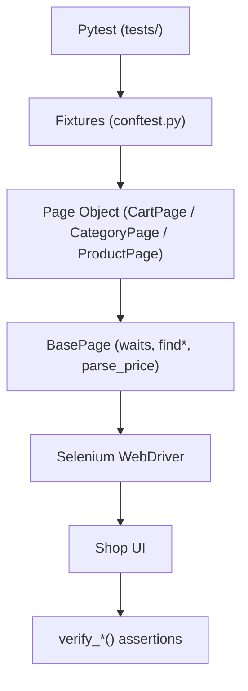

# Framework architecture

How the UI automation code is organized and where to add a page or scenario.

**Language:** English · [Русский](../ru/architecture.md)

UI contract: [`brd.md`](brd.md). Test expectations: [`qa-requirements.md`](qa-requirements.md) (~33 test-IDs).

---

## Data flow

```text
Pytest
  → fixtures (conftest.py: driver, *_page)
  → Page Object (CartPage / CategoryPage / ProductPage)
  → BasePage (waits, find*, set_input_value, parse_price, verify_*)
  → Browser (Selenium WebDriver)
  → Shop UI
  → verify_* / assert
```



---

## Layers

| Layer | Path | Role |
|-------|------|------|
| Tests | `tests/` | scenarios, markers, `@parametrize`, Allure feature/story |
| Fixtures | `conftest.py` | `driver`, `cart_page`, `category_page`, `product_page` |
| Page Objects | `pages/` | actions and `verify_*` |
| Locators | `pages/locators/` | `(By, selector)` tuples |
| Base | `pages/base_page.py` | open, find*, input helpers, waits, shared verify |
| Utils | `utils/` | EC, `run_config`, Allure env/attach helpers |
| Config | `.env`, `BASE_URL` / `BROWSER` / `HEADLESS` / `LOCAL_LOG` | stand, browser, window mode, local log |

---

## Key classes

| Class | File | Purpose |
|-------|------|---------|
| `BasePage` | `pages/base_page.py` | `open_page`, waits, `set_input_value`, `parse_price`, shared `verify_*` |
| `CartPage` | `pages/cart_page.py` | cart, modal → cart, qty/total AJAX, remove, Checkout CTA |
| `CategoryPage` | `pages/category_page.py` | search, sort by price, hover ATC, open PDP |
| `ProductPage` | `pages/product_page.py` | price, qty (± / direct input), ATC `#add_to_cart`, breadcrumb, Terms |

Inheritance: page classes → `BasePage`. Locators stay **outside** page classes.

---

## Patterns

- **Asserts on page objects** — `verify_*` methods (not moved into test helpers for purity).
- **Explicit waits** — `WebDriverWait` + EC; custom `text_to_be_not_empty`; for AJAX (cart qty/total) wait until value/text changes.
- **Data-driven** — `@pytest.mark.parametrize` for case/partial search, malicious input, invalid qty.
- **Markers** — page (`cart`/`category`/`product`) + severity (`smoke`/`critical`/`medium`) + `negative` / `regression` + `mobile` (viewport 390×844).
- **Allure** — `@allure.step` on actions; on failure: `page_url` / `screenshot` / `page_source` / `console_log`; `environment.properties` in `pytest_sessionfinish` (xdist-safe).
- **Isolation for xdist** — function-scoped `driver`: one test = one fresh browser session (empty anonymous cart on the demo stand); locally `make parallel`, in CI `-n 2`.
- **Search** — `search_product` uses JS set value/click (stable on the Odoo-like widget).
- **Prices** — `parse_price` normalizes `$ 2,350.00` → `float` (sort / cart total). Handles comma as thousands separator and dot as decimal; configurable for other locales.
 
---
 
## Adding a page

1. Locators → `pages/locators/<name>_locators.py`
2. Class → `pages/<name>_page.py` (`page_url`, actions, `verify_*`)
3. Fixture in `conftest.py`
4. Tests in `tests/test_<name>.py` + marker in `pytest.ini`

Fixtures: [`fixtures-reference.md`](fixtures-reference.md).

---
 
*Last updated: 2026-11-08*
