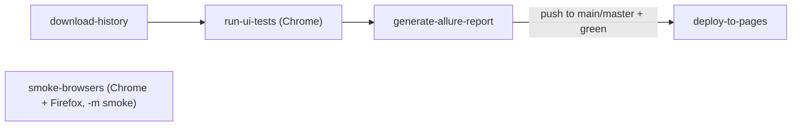

# CI/CD

GitHub Actions: headless Chrome (full suite) + Chrome/Firefox smoke matrix, Allure, Pages.

**Language:** English · [Русский](../ru/ci-cd.md)

Workflow: [`.github/workflows/ui-tests.yml`](../../.github/workflows/ui-tests.yml).

---

## Triggers

| Event | Behavior |
|-------|----------|
| `push` to `main` / `master` | tests + Allure + **Pages deploy** |
| `pull_request` to `main` / `master` | tests + Allure (no deploy) |
| `workflow_dispatch` | manual run; suite: `all` / `critical` / `medium` / `smoke` / `negative` / `regression` (form default is `critical`) |

Local Make targets match: `make negative`, `make regression`. Push/PR CI always runs the full suite (`all`) — the `workflow_dispatch` suite picker only affects manual runs.

---

## Secrets

| Secret | Purpose |
|--------|---------|
| `BASE_URL` | shop stand URL |

`BROWSER` in the main job (`run-ui-tests`) is fixed to Chrome — full regression / Pages / Trends come from there only.  
A separate `smoke-browsers` job runs `-m smoke` on **chrome and firefox** (`--browser` from the matrix).  
`HEADLESS` / `LOCAL_LOG` are **not** set in the workflow — defaults apply (headless, no local log file). Locally: `make firefox` / `pytest -m smoke --browser firefox`.

If `BASE_URL` is empty, the job fails on the secrets check (honest fail).

---

## Jobs (summary)

1. **download-history** — previous Allure history (trends).
2. **run-ui-tests** — Chrome, selected suite; pip install (+ `requirements-dev`) → **mypy** → pytest `-n 2 --reruns 1 --reruns-delay 1` → upload `allure-results` (Pages/Trends source).
3. **smoke-browsers** — matrix `chrome`/`firefox`, smoke only (`--reruns 1`); **no** `needs` (runs in parallel with download-history); downloadable `allure-smoke-*` artifacts, **not** merged into Pages.
4. **generate-allure-report** — from `run-ui-tests` only (`if: always()`) → Allure generate → Pages artifact **only on push** to `main`/`master`.
5. **deploy-to-pages** — only `push` to `main`/`master` **and** a green `run-ui-tests` (a red firefox smoke fails the workflow/PR check but does **not** block Pages).

`smoke-browsers` does not depend on `download-history` and does not feed `generate-allure-report` / Pages — it is a separate, parallel quality signal (downloadable `allure-smoke-*`).

`concurrency` cancels the previous run on the same ref (`cancel-in-progress`).  
Permissions: workflow — `contents/actions: read`; `pages`/`id-token: write` only on `deploy-to-pages`.

---

## Honest CI

- Pytest step has **no** `continue-on-error`.
- CI retries once (`--reruns 1`) — local default has no retry, so debugging does not mask bugs.
- Allure upload / generate use `if: always()` so reports exist on red runs.
- `environment.properties` is generated by pytest automatically — nothing is hand-placed in the workflow.
- Pages deploy does not run on PRs.

---

## Pages

After the first successful deploy: Settings → Pages → Source = **GitHub Actions**.  
Report: `https://aliaksandr-stanavy.github.io/ui-selenium-test-automation-framework/`.

Failure triage: [`test-analysis.md`](test-analysis.md).

---
 
*Last updated: 2026-11-08*
