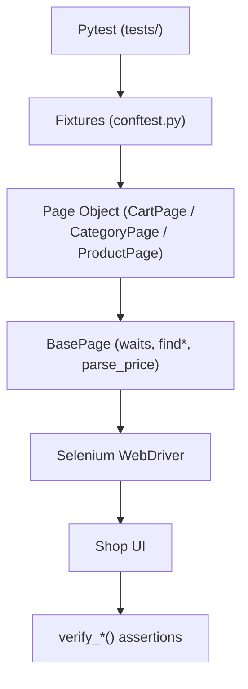

# Архитектура фреймворка

Как устроен код UI-автотестов и куда добавлять новую страницу или сценарий.

**Язык:** Русский · [English](../en/architecture.md)

Контракт UI: [`brd.md`](brd.md). Ожидания тестов: [`qa-requirements.md`](qa-requirements.md) (~33 test-ID).

---

## Поток данных

```text
Pytest
  → fixtures (conftest.py: driver, *_page)
  → Page Object (CartPage / CategoryPage / ProductPage)
  → BasePage (waits, find*, set_input_value, parse_price, verify_*)
  → Browser (Selenium WebDriver)
  → Shop UI
  → verify_* / assert
```



---

## Слои

| Слой | Путь | Роль |
|------|------|------|
| Тесты | `tests/` | сценарии, маркеры, `@parametrize`, Allure feature/story |
| Фикстуры | `conftest.py` | `driver`, `cart_page`, `category_page`, `product_page` |
| Page Objects | `pages/` | действия и `verify_*` |
| Локаторы | `pages/locators/` | кортежи `(By, selector)` |
| База | `pages/base_page.py` | open, find*, input helpers, waits, общие verify |
| Utils | `utils/` | EC, `run_config`, Allure env/attach helpers |
| Конфиг | `.env`, `BASE_URL` / `BROWSER` / `HEADLESS` / `LOCAL_LOG` | стенд, браузер, окно, локальный лог |

---

## Ключевые классы

| Класс | Файл | Назначение |
|-------|------|------------|
| `BasePage` | `pages/base_page.py` | `open_page`, waits, `set_input_value`, `parse_price`, shared `verify_*` |
| `CartPage` | `pages/cart_page.py` | корзина, modal → cart, qty/total AJAX, remove, Checkout CTA |
| `CategoryPage` | `pages/category_page.py` | поиск, sort по цене, hover ATC, переход на PDP |
| `ProductPage` | `pages/product_page.py` | цена, qty (± / direct input), ATC `#add_to_cart`, breadcrumb, Terms |

Наследование: page classes → `BasePage`. Локаторы **не** смешиваются с page-классами.

---

## Паттерны

- **Asserts на page object** — методы `verify_*` (не выносятся в тесты «ради чистоты»).
- **Explicit waits** — `WebDriverWait` + EC; custom `text_to_be_not_empty`; для AJAX (qty/total в корзине) — wait на смену value/текста.
- **Data-driven** — `@pytest.mark.parametrize` для case/partial search, malicious input, invalid qty.
- **Маркеры** — page (`cart`/`category`/`product`) + severity (`smoke`/`critical`/`medium`) + `negative` / `regression` + `mobile` (viewport 390×844).
- **Allure** — `@allure.step` на действиях; при падении: `page_url` / `screenshot` / `page_source` / `console_log`; `environment.properties` в `pytest_sessionfinish` (xdist-safe).
- **Изоляция для xdist** — `driver` function-scoped: один тест = одна свежая браузерная сессия (пустой anonymous cart на демо-стенде); локально `make parallel`, в CI `-n 2`.
- **Поиск** — `search_product` использует JS set value/click (стабильность Odoo-like виджета).
- **Цены** — `parse_price` нормализует `$ 2,350.00` → `float` (sort / cart total).

---

## Как добавить страницу

1. Локаторы → `pages/locators/<name>_locators.py`
2. Класс → `pages/<name>_page.py` (`page_url`, действия, `verify_*`)
3. Фикстура в `conftest.py`
4. Тесты в `tests/test_<name>.py` + маркер в `pytest.ini`

Фикстуры: [`fixtures-reference.md`](fixtures-reference.md).

---
 
*Last updated: 2026-11-08*
