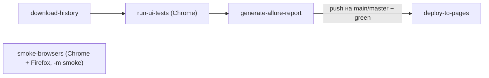

# CI/CD

GitHub Actions: headless Chrome (full suite) + Chrome/Firefox smoke matrix, Allure, Pages.

**Язык:** Русский · [English](../en/ci-cd.md)

Workflow: [`.github/workflows/ui-tests.yml`](../../.github/workflows/ui-tests.yml).

---

## Триггеры

| Событие | Поведение |
|---------|-----------|
| `push` на `main` / `master` | тесты + Allure + **deploy Pages** |
| `pull_request` на `main` / `master` | тесты + Allure (без deploy) |
| `workflow_dispatch` | ручной запуск; suite: `all` / `critical` / `medium` / `smoke` / `negative` / `regression` (default в форме — `critical`) |

Локально те же срезы: `make negative`, `make regression`. На push/PR CI всегда гоняет полный suite (`all`) — выбор suite в `workflow_dispatch` влияет только на ручной запуск.

---

## Secrets

| Secret | Назначение |
|--------|------------|
| `BASE_URL` | URL стенда магазина |

`BROWSER` в основном job (`run-ui-tests`) фиксирован как Chrome — полный regress / Pages / Trends только оттуда.  
Отдельный job `smoke-browsers` гоняет `-m smoke` на **chrome и firefox** (`--browser` из matrix).  
`HEADLESS` / `LOCAL_LOG` в workflow **не задаются** — действуют defaults (headless, без локального лога). Локально: `make firefox` / `pytest -m smoke --browser firefox`.

Если `BASE_URL` пуст — job падает на шаге проверки secrets (честный fail).

---

## Jobs (кратко)

1. **download-history** — предыдущая Allure history (trends).
2. **run-ui-tests** — Chrome, выбранный suite; pip install (+ `requirements-dev`) → **mypy** → pytest `-n 2 --reruns 1 --reruns-delay 1` → upload `allure-results` (источник Pages/Trends).
3. **smoke-browsers** — matrix `chrome`/`firefox`, только `-m smoke` (`--reruns 1`); **без** `needs` (параллельно с download-history); артефакты `allure-smoke-*` downloadable, **не** мержатся в Pages.
4. **generate-allure-report** — только от `run-ui-tests` (`if: always()`) → Allure generate → Pages artifact **только на push** в `main`/`master`.
5. **deploy-to-pages** — только `push` на `main`/`master` **и** green `run-ui-tests` (красный firefox smoke помечает workflow/PR check, но **не** блокирует Pages).

`smoke-browsers` не зависит от `download-history` и не влияет на `generate-allure-report` / Pages — это отдельный, параллельный сигнал качества (downloadable `allure-smoke-*`).

`concurrency` отменяет предыдущий run на том же ref (`cancel-in-progress`).  
Permissions: workflow — `contents/actions: read`; `pages`/`id-token: write` только у `deploy-to-pages`.

---

## Честность CI

- Шаг pytest **без** `continue-on-error`.
- CI retries once (`--reruns 1`) — локальный default без retry, чтобы не маскировать баги при отладке.
- Allure upload / generate — `if: always()`, чтобы отчёт был и при красных тестах.
- `environment.properties` генерируется в pytest автоматически — в workflow вручную ничего не кладём.
- Deploy Pages не запускается на PR.

---

## Pages

После первого успешного deploy: Settings → Pages → Source = **GitHub Actions**.  
Отчёт: `https://aliaksandr-stanavy.github.io/ui-selenium-test-automation-framework/`.

Анализ падений: [`test-analysis.md`](test-analysis.md).

---
 
*Last updated: 2026-11-08*
